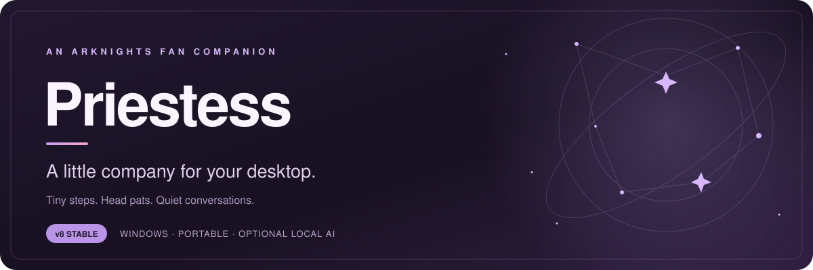
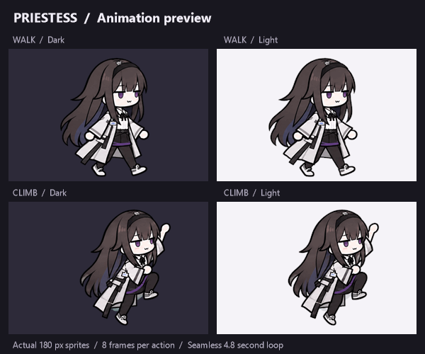
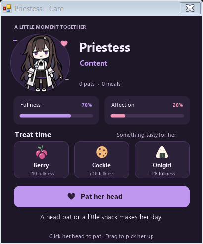
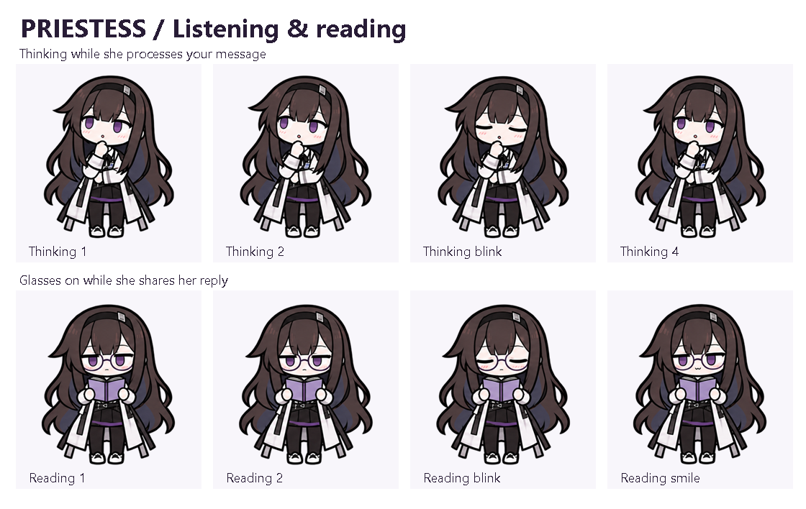

<div align="center">



**An unofficial Arknights desktop companion for Windows.**<br>
Let her wander, perch on your windows, enjoy a snack, and keep you company.

[](https://github.com/grubkrow/priestess-desktop-pet/releases/latest)
[](docs/QUICKSTART.md)
[](#download--start)

**[Download](https://github.com/grubkrow/priestess-desktop-pet/releases/latest) · [Setup guide](docs/QUICKSTART.md) · [Troubleshooting](docs/TROUBLESHOOTING.md) · [Report a bug](https://github.com/grubkrow/priestess-desktop-pet/issues)**



</div>

## Your little desktop companion

| A place beside you | A little care | A conversation, on your PC |
| :--- | :--- | :--- |
| Drag her around, let her walk, or sit her on a window. She follows when that window moves. | Pat her head and offer a berry, cookie, or onigiri. Fullness and affection carry over between sessions. | Optional local AI chat with text, images, and document attachments. Thinking poses and reading glasses included. |

- **48 animation frames**, with walking, climbing, sleeping, care, thinking, and reading poses.
- **Three sizes and speeds**, an always-on-top option, and a tray menu.
- **Portable Windows app:** no installer, administrator access, Java, or Shimeji-ee required.
- **Optional Gemma 3 4B chat through Ollama:** no account, API key, or monthly subscription. Hardware determines response speed.

This repository contains **stable Priestess v8 only**. Screen awareness and Odysseus are not part of this release. Priestess does **not** capture your desktop; you can give her context by attaching files yourself.

## Download & start

1. Open **[the latest release](https://github.com/grubkrow/priestess-desktop-pet/releases/latest)** and download **`Priestess-v8-Windows.zip`** under **Assets**.
2. Right-click the ZIP → **Extract All** into a folder you can write to. Keep all the extracted files together.
3. Open the extracted folder and double-click **`Priestess.exe`**.
4. **Right-click Priestess or her tray icon** to see actions, care, chat, size, and speed.

Requires **Windows 10/11 and .NET Framework 4.8**. The optional AI setup uses the 64-bit Windows Ollama runtime. The pet works without AI. Download the release ZIP above; GitHub's **Code → Download ZIP** is source code and does not contain the ready-to-run app.

### Add local AI (optional)

Open **Windows PowerShell in the extracted pet folder**, then run:

```powershell
powershell.exe -NoProfile -ExecutionPolicy Bypass -File .\Setup-local-AI.ps1
```

Setup downloads Ollama and **Gemma 3 4B** once. Allow several gigabytes of free space and keep the window open until it finishes. Put the pet on a drive with plenty of room before starting. After setup, open **Chat with Priestess...** from her menu; ordinary chat works offline.

The model is **not bundled** in the pet ZIP. See the **[setup guide](docs/QUICKSTART.md)** for the full steps and moving an existing AI folder.

## Spend a moment together

<table>
<tr>
<td width="42%" align="center"></td>
<td valign="top">

### Care & snacks

Click her head for a pat, or open **Care & snacks...**. Give her a treat and watch her react. Care progress is saved beside the app in `priestess-care.xml`.

### Sit on a window

Choose **Sit on a window**, or drag her above a visible, restored window and release. She follows it as it moves and resizes.

### Thinking & reading

She thinks while preparing a reply, then puts on her glasses to share it. Drag files into chat or use **Attach files...** to provide context.

</td>
</tr>
</table>

<details>
<summary><strong>See the thinking and reading sprites</strong></summary>



</details>

## Controls at a glance

| Action | How |
| :--- | :--- |
| Move Priestess | Drag her body, then release |
| Head pat | Click her head, or choose **Pat her head** |
| Care / feed | **Care & snacks...** or **Feed a snack** |
| Chat | **Chat with Priestess...** → type → **Enter** / **Send** |
| New line in chat | **Shift+Enter** |
| Give her a file | Drop it into chat or choose **Attach files...** |
| Shrug | Double-click her body |
| Recover an off-screen pet | Tray menu → **Bring Priestess back** |
| Change size / speed / action / quit | Right-click Priestess or her tray icon |

Chat supports text/code files, DOCX, PDFs with selectable text, and PNG/JPG/BMP/GIF images. Attach up to **4 files**, including up to **2 images**, with a **20 MB per-file limit**. Closing chat or starting a new conversation clears the current conversation and attachments; care progress is saved separately.

## For builders

The app is written in C# using Windows Forms and .NET Framework 4.8. Sprite sheets and required document-reading libraries are included in `source/`.

```powershell
powershell.exe -NoProfile -ExecutionPolicy Bypass -File .\source\build.ps1
```

See **[build notes](source/README.md)** and **[release verification](docs/VERIFICATION.md)**. The downloadable executable is the preserved stable v8 build; this publication also repairs the separate first-time AI setup script.

## Credits

An **unofficial fan project**, unaffiliated with Arknights or its creators. Priestess and Arknights belong to their respective rights holders. Sprite artwork was generated with ImageGen using a supplied style reference; [art notes](Art-prompts.md) preserve the available prompts.

Optional AI uses [Ollama](https://github.com/ollama/ollama) and [Gemma 3](https://ai.google.dev/gemma/terms). PDF reading uses [PdfPig](https://github.com/UglyToad/PdfPig). See [third-party notices](Third-party-notices.md) and [bundled licenses](licenses/) for dependency terms. Those licenses apply to their respective components; this repository does not grant a new license to the Arknights character or artwork.
